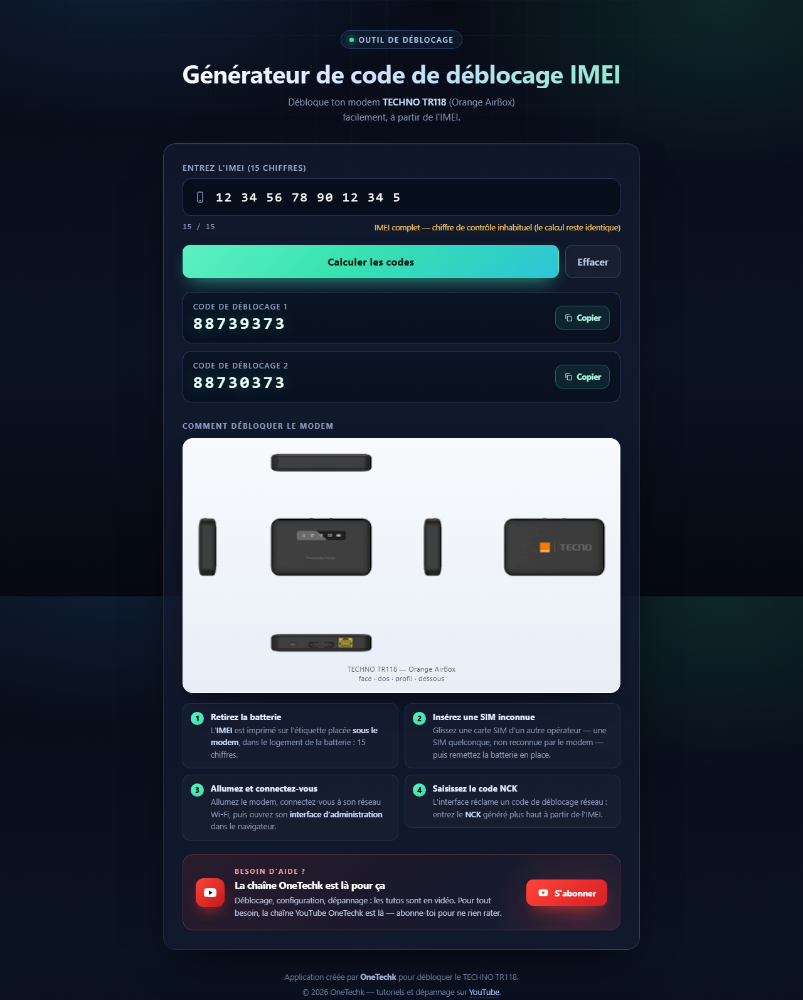

# Bogims Unlock — Générateur de code NCK (TECHNO TR118)

**Démo en ligne : <https://bogims-next.vercel.app>**

Portage **Next.js** du clone du générateur de code de déblocage IMEI.
L'application calcule les deux codes **NCK** du modem **TECHNO TR118** (Orange AirBox)
à partir des 15 chiffres de l'IMEI — **entièrement dans le navigateur**.

> Aucun appel réseau : le calcul est fait côté client, dans `lib/imei.ts`.

---

## Stack

| Élément | Version |
|---|---|
| Next.js (App Router, Turbopack) | 16.4 |
| React | 19.3 |
| TypeScript | strict |
| CSS | global, sans framework (`app/globals.css`) |
| Tests | `node --test` (Node 22+, type-stripping natif) |

## Démarrage

```bash
npm install
npm run dev      # http://localhost:3000
```

Production :

```bash
npm run build
npm start        # http://localhost:3000
```

Tests de non-régression (17 IMEI réels + cas limites) :

```bash
npm test
```

Lien direct pré-rempli : `http://localhost:3000/?imei=123456789012345`.

## Arborescence

```
app/
  layout.tsx        métadonnées, viewport, favicon
  page.tsx          page serveur (statique) : en-tête, formulaire, procédure, footer
  globals.css       tout le design (repris du clone statique)
components/
  ImeiForm.tsx      composant client : saisie, validation, calcul, copie
lib/
  imei.ts           cœur métier pur (testé) : computeCodes, luhnValid, formatImei
public/
  assets/modem.png  visuel du modem (détouré)
  favicon.svg
tests/
  imei.test.mjs
```

`page.tsx` est un composant serveur ; seul `ImeiForm` est `"use client"`.
La page est **pré-rendue statiquement** (`○ /`) : aucun serveur requis pour l'affichage.

## L'algorithme

Soit `d[0..14]` les 15 chiffres de l'IMEI :

```
x1 = (d[8]  + d[9])  mod 10
y  = (d[10] + d[11]) mod 10
z  = (d[12] + d[13]) mod 10

code1 = "8873" + x1 + y + z + "3"
code2 = "8873" + d[9] + y + z + "3"
```

- les 8 premiers chiffres (TAC) et le 15ᵉ (Luhn) sont ignorés ;
- les sommes sont faites chiffre par chiffre puis modulo 10 (`9 + 9 → 8`) ;
- `8873` et `3` sont des constantes du modèle.

Implémentation : `lib/imei.ts` — vérifiée sur **94 échantillons** réels du service d'origine
(les 17 cas représentatifs sont dans `tests/imei.test.mjs`).

## Aperçu



## Déploiement

- **Vercel** : importer le dépôt, aucune variable d'environnement nécessaire.
- **Hébergement statique** : ajouter dans `next.config.mjs`

  ```js
  export default { output: "export", images: { unoptimized: true } };
  ```

  puis `npm run build` génère `out/`, à déposer tel quel.

## Détails d'interface

- saisie formatée par groupes de 2, compteur, validation 15 chiffres ;
- contrôle Luhn **non bloquant** (signalé, le calcul reste identique) ;
- affichage séquencé : code 1, puis code 2 après ~420 ms ;
- boutons « Copier » avec repli `execCommand` hors contexte sécurisé ;
- responsive (grille de procédure en 1 colonne < 700 px), `prefers-reduced-motion` respecté.
